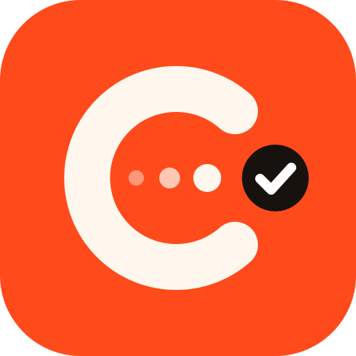
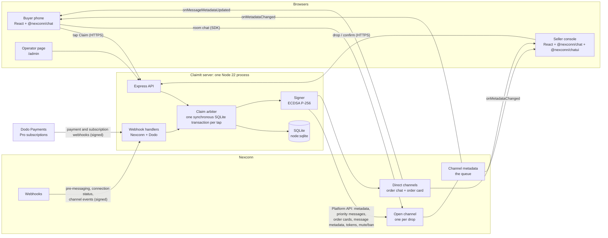

<p align="center">
  
</p>

<h1 align="center">ClaimIt</h1>

<p align="center"><b>Fair live drops for social sellers.</b><br>
"Comment MINE to buy" becomes a first-come claim queue that every viewer can see, and it ends in a paid order.</p>

<p align="center">
  Built for the <b>Nexconn Build Challenge 2026</b> on the Nexconn Chat SDK, Chat UI kit, Platform API and webhooks.
</p>

## Links

| What | Where |
|---|---|
| Live app | <https://35-224-27-222.sslip.io> |
| Try a drop as a buyer (always-on practice room) | <https://35-224-27-222.sslip.io/d/demo> |
| Open a shop as a seller | <https://35-224-27-222.sslip.io/sell> |
| Pricing | <https://35-224-27-222.sslip.io/pricing> |
| Business model canvas and unit economics | <https://35-224-27-222.sslip.io/business> |
| Demo video (2:16) | _YouTube link added at submission_ |
| How the demo video was made | [demo-video/README.md](demo-video/README.md) |
| Nexconn Console | <https://console.nexconn.ai> |

## The problem

Millions of social sellers run live sales on Instagram, TikTok, Facebook, YouTube and WhatsApp: thrift stores, boutiques, jewellers, plant shops and collectors, from the US to the Philippines to India. Their checkout is still "comment SOLD" or "comment MINE". Forty people comment in the same second, nobody agrees who was first, and the seller chases payment in DMs.

## What ClaimIt does

1. **One link.** The seller shares it to their story or group. Buyers join in a tap, with no app and no password.
2. **One Claim button.** The first tap wins. Everyone sees "Held by Priya · 4:12 · 2 in line".
3. **Checkout in chat.** The winner gets a private order chat with the seller's payment link (PayPal, Stripe, GCash, UPI and others) and a timer. If they don't pay in time, the next person in line is promoted automatically, live, in front of the room.

| For the seller | For the buyer |
|---|---|
| A shop and a live drop in under a minute | No app, no account: a name is enough |
| A console that shows who holds what and who has paid | Their place in line, live, on every screen |
| One-tap payment confirmation and a shipping list (CSV) | An order card that updates in place: waiting, paid, confirmed |
| A recap with sales rescued from no-shows | A shop trust line: confirmed orders, confirm speed, reports |
| Pro: co-hosts, scheduled drops, lifetime analytics | Follow a shop and get told when it goes live |

## Architecture



**Why it is built this way**

- **Claims go through our server, not through chat.** Two buyers who tap in the same millisecond hit one synchronous SQLite transaction in one process, so exactly one wins. `npm run test:race` proves it with 200 simultaneous claims.
- **State travels through Nexconn, not through polling.** After each commit the server writes the new queue to the open channel's metadata, and every browser gets it from the SDK's `onMetadataChanged`.
- **Nothing on screen is taken on trust.** Any participant's SDK can write channel metadata, so every value is signed by the server and verified in the browser with WebCrypto before it is shown. Order-card statuses are signed the same way.
- **The App Secret never leaves the server.** Browsers get short-lived access tokens.

## How it uses Nexconn

ClaimIt is not a chat app with a shop bolted on. The claim queue itself lives in Nexconn: the room is an open channel, the queue is that channel's metadata, the order is a direct-channel message whose metadata changes in place, and the rules are enforced in Nexconn's webhooks.

| Feature | Nexconn capability |
|---|---|
| Live drop room for any number of viewers | **Open channel**, created server-side for each drop and joined through the Web Chat SDK |
| Live claim queue that every viewer sees update at the same moment | **Open channel metadata (KV)**, written by the server arbiter with per-item versions; clients use `onMetadataChanged`. Viewers' SDKs can write metadata too, so every value is **signed by the server** (ECDSA P-256, bound to channel and key) and clients verify it with WebCrypto before showing it. A forged queue or a fake "drop ended" never reaches the screen |
| Drops and claim events always get through, fan chat is dropped first under load | **Priority message types** (`CI:Drop`, `CI:Event`) plus a **low-priority type** (`CI:Chat`), registered by `npm run setup:nexconn`; server sends use `priority: 2` |
| Anti-scam room chat: phone numbers, emails and payment handles masked, sender names forced to their real value, and repeat offenders muted after 3 attempts with Nexconn's native **open-channel mute** (`/v4/open-channel/participant/mute-list/add`) | **Pre-message webhook** (`open_channel:pre_messaging`): Nexconn holds each message until our server passes, rewrites or blocks it |
| Order cards can't be forged, and buyers can't DM each other ("pay me instead" scams on people in line) | **Pre-message webhook** (`direct_channel:pre_messaging`): only shops may send `CI:*`, and every DM must involve a shop. A shop may only message buyers who claimed in its drops or follow it, so a rogue shop can't target ids scraped from another shop's queue |
| The seller answers the room live, with quick replies | `CI:SellerChat`, a **priority** type sent by the server as the shop, so replies are never shed with fan chat. Buyers see a server-verified Seller badge |
| Presence-aware queue: buyers who have been offline for 10+ minutes are skipped (and told why). A holder offline for 10+ minutes who never opened the payment page loses the hold early, but only if someone is waiting. Ten minutes, because buyers watching the seller's Instagram or TikTok Live keep this tab in the background | **User connection-status webhook** (`user:connection_status`) |
| Order card whose status updates in place (waiting for payment, then paid, then confirmed) | **Direct channel** custom message `CI:Order`, sent with `hasMetadata`; the server updates it through **message metadata** (`/v4/channel-type/message/metadata/set`), and clients use `onMessageMetadataUpdated`. Each status is server-signed, so a buyer editing their own card's metadata can't make it say "paid" |
| Buyer and seller order chat | Direct channel: text through the SDK, plus `CI:OrderUpd` status messages |
| Seller inbox on desktop | **Nexconn Chat UI** (`@nexconn/chatui`), with custom Web Component bubbles that render live order cards |
| Followers notified when a shop opens a new drop | Direct channel batch send (up to 1,000 recipients per call) |
| Live viewer count | `/v4/open-channel/get` (server, cached for 5s) plus participant events |
| Demo room's "next item in 6s" countdown | Open channel metadata (`drop.nextAt`) |
| Freeing metadata space after a drop ends | **Metadata batch remove** (`/v4/open-channel/metadata/batch/remove`), 10 minutes after the end |
| Identity | Server-issued **access tokens**. The App Secret never reaches the browser. Pro co-hosts get their own identity (`c_<id>`), never the shop's: the webhooks only accept it while the co-host is on the team and the shop is on Pro. Removing a co-host also **expires their tokens** (`/v4/auth/access-token/expire`) and **bans them from the shop's live rooms** (`/v4/open-channel/participant/ban-list/add`) |

The **claim arbiter** runs on the app server. Every state change is a single synchronous SQLite transaction in one Node process, so two buyers who tap in the same millisecond can never both win. After each commit, the server publishes the new queue to the open channel's metadata, sends a priority event to the room, and sends or updates the winner's order card.

The Nexconn webhook path has its own proof too: `npm run test:webhooks` (server started with test keys and `FORCE_MOCK=1`) sends signed webhooks shaped like Nexconn's documented payloads and checks signature, expiry and replay protection, plus the pre-message rules: buyers can't message other buyers or send order cards, a message with no recipient isn't delivered, a shop can't send order cards to another shop's customer, faked sender names are replaced, payment details are masked, and buyers can't post fake drops or claim events.

Billing has its own proof: `npm run test:billing` (with `DODO_WEBHOOK_SECRET` set to the server's) sends signed Dodo webhooks and checks the Pro time a shop ends up with across partial payments, duplicate deliveries, partial refunds, disputes and won disputes, unknown currencies, operator approvals, and the full subscription life cycle (subscribe, renew, failed renewal, cancel).

Prove it: with the mock server running, `npm run test:race` fires 200 simultaneous claims at one item and checks for exactly one winner, a gap-free waitlist in tap order, a public state that matches what each buyer was told, and correct promotion when the winner lets go. It also checks that a paid or sold item can't be pulled or dropped again, that a racing confirm and reject resolve to exactly one decision, and that "Run again" never copies an item someone is still holding.

**Reliability details:**

- Metadata writes are versioned and idempotent, so they're retried with backoff. On boot, the server republishes every live drop's state. Message sends are not retried on the backup host unless the request never left, so nothing is delivered twice.
- An order card whose send failed is sent again once. A sold or "buyer says paid" item can't be pulled or re-sold.
- A claim whose buyer says they paid is never auto-released, because money may have moved. Instead the seller gets a reminder after 5 and 15 minutes from ClaimIt's system user, and the people in line are told they keep their place.
- Each item's queue is one metadata key, and an open channel holds 100, so a drop holds up to 90 items.
- When a buyer's connection comes back, the room resyncs metadata, the drop and their claims straight away.
- Buyers watching the seller's Instagram or TikTok Live have this tab in the background, so the queue only skips people who've been gone 10+ minutes. Everyone else is promoted and gets a push-enabled order message.

**Webhook setup** (Console → Chat → Chat settings → Webhooks). The two pre-messaging events must be switched on in the Console for server-side masking and the native mute to take effect; until then the same masking runs in every browser:

- URL: `https://<your-host>/api/nexconn/webhook`
- Events: `user:connection_status`, `open_channel:pre_messaging` and `direct_channel:pre_messaging` (blocks order cards sent by anyone but a shop)
- Requests are verified with `sha1(AppSecret + Nonce + Timestamp)`.

**Notes on scope:**

- Shops choose a currency. Buyers pay the seller directly: by UPI, by the seller's own payment link (PayPal.me, Venmo and Cash App links get the amount pre-filled; Stripe, Wise and others work as-is), or by account details the seller types once (GCash number, bank account, Zelle email). The buyer taps "I've paid" and adds an optional transaction ID, then the seller confirms in one tap. ClaimIt never holds money.
- Low-priority shedding is a Nexconn server behaviour under load (more than about 40 messages per 200 ms in a room). ClaimIt configures it but doesn't simulate floods.

## Business model

The full Business Model Canvas, unit economics and impact are in the app at `/business`. Here's what's real in the product today:

- **Revenue:** Pro is $9 a month, flat, with 0% commission. The 14-day trial needs no card, and invited shops get 30 days. Pro unlocks:
  - co-hosts
  - lifetime analytics: no-show rate, repeat buyers, time to pay and best hour
  - scheduled drops, with a countdown and calendar invites

  The first 100 shops are founding sellers at $4.50. Shops pay through Dodo Payments: a checkout tagged with the shop id, and a signed `payment.succeeded` webhook adds 30 days automatically, but only if the amount covers the shop's price (refunds and disputes take the time back). Without Dodo configured, shops can pay ClaimIt's own payment link (`PRO_PAY_LINK` / `PRO_PAY_NOTE`) and submit a reference. An operator confirms it at `/admin`, which adds 30 days; renewals stack, and Pro lapses back to Free with nothing lost. A card processor's webhook can replace the operator step without other changes.
- **Measurable value:** every drop recap and the seller home show sales rescued from no-shows (expired holds only) and races settled.
- **Channels:**
  - Seller-to-seller invite links: the invited shop gets 30 days of Pro, and the inviter gets a month after the invited shop's first sale.
  - Buyer share links track which shares bring people in.
  - Followers are notified of new drops, at most once every 30 minutes.
- **Buyer protection for direct payment:** a "Report this shop" button. The trust line shows confirmed orders and confirm speed, plus a warning when a shop has several reports or rejects many payments.

### Taking Pro payments with Dodo Payments (test mode first)

1. In the Dodo dashboard, switch to **Test mode**. Create a one-time product, "ClaimIt Pro (30 days)", at $9. Optionally create a second at $4.50 for founding sellers.
2. Copy each product's payment link, for example `https://test.checkout.dodopayments.com/buy/pdt_…`.
3. Add a webhook endpoint `https://<your-host>/api/dodo/webhook` for `payment.succeeded`, `refund.succeeded`, `dispute.opened`, `dispute.won` and `dispute.cancelled`, and copy its signing secret (`whsec_…`).
4. In `.env`, set `DODO_PRO_LINK`, `DODO_PRO_LINK_FOUNDING` (optional) and `DODO_WEBHOOK_SECRET`, then deploy.

**Auto-renewing Pro.** Make the Dodo product a monthly **subscription** instead of a one-time payment, use its payment link, set `DODO_PRO_RECURRING=1`, and also subscribe the webhook to the `subscription.*` events. Nothing else changes:

- Every charge (the first and each renewal) arrives as `payment.succeeded` with a `subscription_id` and buys the month. A renewal that carries only the subscription id is matched to the shop that subscribed.
- `subscription.active` / `renewed` / `cancelled` / `on_hold` / `past_due` / `failed` / `expired` keep the shop's Pro card accurate: "Renews automatically on …", "Subscription cancelled: Pro stays on until …", or "Your renewal payment didn't go through".
- Cancelling never takes away days already paid for, and shops on an active subscription get no renewal reminders.

ClaimIt adds the shop's id to the checkout link (`metadata_sellerId`). When Dodo's signed webhook arrives, ClaimIt verifies it (Standard Webhooks HMAC with a 5-minute window) and adds 30 days of Pro. Repeat deliveries of the same payment don't add time twice. In test mode, pay with card `4242 4242 4242 4242`, expiry 06/32, CVV 123: no real money moves. To go live, swap in the live links and secret.

## Run locally

Works on macOS, Linux and Windows. You need **Node.js 22.13 or newer** (the server uses the built-in `node:sqlite`) and npm. No database to install and no Nexconn account needed for a first run.

```bash
npm install
cp .env.example .env      # Windows: copy .env.example .env   (leave the Nexconn keys empty for mock mode)
npm run dev               # web on http://localhost:5173, API on :8787
```

Then open <http://localhost:5173>, create a shop at `/sell`, and open the drop link in a second window as a buyer.

With no keys set, the app runs in **mock mode**: a local server-sent-events stand-in with the same surface as the SDK. You can build and test it offline. Open the room with `?as=anyname` to act as several buyers in one browser.

### Connect to Nexconn

1. Create a free account and app at <https://console.nexconn.ai>. Copy the **App Key** and **App Secret** into `.env`.
2. In the Console, enable these services for the app:
   - Open channel **metadata**
   - Open channel **message priority**
   - Priority message types
3. Run the one-time setup, which registers the priority and low-priority message types:
   ```bash
   npm run setup:nexconn
   ```
4. Run `npm run dev` again. `/api/config` should now return `"mode":"nexconn"`.


On Windows, `npm run dev:mock` and `npm start` use shell-style environment variables; run them from Git Bash or WSL, or use `npm run dev` with empty keys instead.

## Production

```bash
npm run build && npm start   # serves the built web app and the API from one Node process
```

Run it as a single instance with a persistent disk for `DATA_DIR`, because the arbiter relies on one process.

### Deploy to a VM (Google Compute Engine)

`deploy/` holds a small VM deployment. It uses Node 22 under systemd, with Caddy in front for automatic HTTPS. An `sslip.io` hostname means you don't need a domain.

```bash
# first time: installs Node, Caddy, swap and a service user, then deploys
GCP_PROJECT=<project> HOST=<ip-with-dashes>.sslip.io ./deploy/deploy.sh --bootstrap
# every update after that
GCP_PROJECT=<project> HOST=<ip-with-dashes>.sslip.io ./deploy/deploy.sh
```

The script builds locally and uploads the app. It writes the `NEXCONN_*` keys from your local `.env` to `/etc/claimit.env` on the VM, readable only by root, and restarts the service. Data lives in `/var/lib/claimit`.

## Tests

All three suites run against a local server and print one line per check. They are the output shown at the end of the demo video.

| Command | Checks | What it proves |
|---|---|---|
| `npm run test:race` | 25 | 200 buyers claim one item at once: exactly one winner, a gap-free waitlist in arrival order, correct promotion, signed state that rejects forgeries and replays |
| `npm run test:billing` | 20 | Signed Dodo webhooks: partial payments, duplicates, refunds, disputes, unknown currencies, the full subscription life cycle |
| `npm run test:webhooks` | 16 | Nexconn webhook signature, expiry and replay protection, plus every pre-message rule |
| `npm run typecheck` and `npm run lint` | | TypeScript, and React's rules of hooks |

```bash
# terminal 1
DODO_WEBHOOK_SECRET=whsec_bG9jYWx0ZXN0 ADMIN_KEY=local npm run dev:mock
# terminal 2
npx tsx scripts/race.ts 200 http://localhost:8787
DODO_WEBHOOK_SECRET=whsec_bG9jYWx0ZXN0 ADMIN_KEY=local npx tsx scripts/billing.ts http://localhost:8787
```

`test:webhooks` needs a server started with test keys and the mock transport; the exact two commands are at the top of [scripts/webhooks.ts](scripts/webhooks.ts).

## Project structure

```
claimit/
├── server/                 Express API and everything that talks to Nexconn
│   ├── index.ts            routes, auth, moderation rules, webhooks, Pro billing, operator API
│   ├── engine.ts           the claim arbiter: claim, promote, expire, publish to Nexconn
│   ├── nexconn.ts          signed Platform API client (channels, metadata, messages, tokens, mute/ban)
│   ├── sign.ts             ECDSA signing of queue state and order statuses
│   ├── presence.ts         who is online, from the connection-status webhook
│   ├── db.ts               SQLite schema and migrations
│   ├── demo.ts             the always-on practice room
│   ├── mockbus.ts          offline stand-in for Nexconn (server-sent events)
│   └── setup.ts            one-time registration of the custom message types
├── web/src/
│   ├── rt.ts               one realtime interface over the Nexconn Chat SDK (or the mock)
│   ├── chatui.ts           Nexconn Chat UI inbox with custom order-card bubbles
│   ├── verify.ts           WebCrypto verification of server-signed state
│   ├── pages/              Room (buyer), SellerConsole, SellerHome, Shop, MyOrders, Pricing, Business, Admin
│   └── components/         order chat thread, report-a-shop sheet, shared UI
├── shared/types.ts         message types and state shapes used by both sides
├── scripts/                race, billing and webhook test suites; demo seed
├── deploy/                 VM bootstrap, systemd unit, deploy script
└── demo-video/             the pipeline that recorded, edited, narrated and scored the demo video
```

## Technologies

| Layer | Used |
|---|---|
| Realtime | Nexconn Chat SDK (`@nexconn/chat`, `@nexconn/engine`), Nexconn Chat UI (`@nexconn/chatui`), Nexconn Platform API v4, Nexconn webhooks |
| Web | React 18, Vite, Tailwind CSS 4, React Router, Motion, Sonner, Lucide, WebCrypto |
| Server | Node.js 22, Express, SQLite (`node:sqlite`), TypeScript run with `tsx` |
| Payments | Dodo Payments (Pro subscriptions, test mode), Standard Webhooks signatures. Buyers pay sellers directly; ClaimIt never holds money |
| Hosting | Google Compute Engine VM, systemd, Caddy (automatic HTTPS) |
| Demo video | Playwright, Chrome DevTools screencast, ffmpeg, Remotion, Kokoro text-to-speech, NumPy/SciPy for the score and sound effects |

## AI tools disclosure

- **Development:** the code was written with the help of an AI coding assistant (Claude Code by Anthropic), directed, reviewed and tested by the author. Product decisions, the Nexconn integration design and all testing on the live app are the author's.
- **Demo video narration:** generated locally with the open-weights Kokoro text-to-speech model. It is not a human voice.
- **Demo video music and sound effects:** synthesised by code in [demo-video/voice](demo-video/voice). No samples or licensed tracks.
- **In the product:** ClaimIt itself uses no AI. Moderation is rule-based (pattern matching for phone numbers, emails and payment handles).
- **Product images:** the three item pictures in the practice room are illustrations made for the demo.

## License

[MIT](LICENSE) © 2026 Tushar Agarwal

The Nexconn SDKs are used under their own licences.
